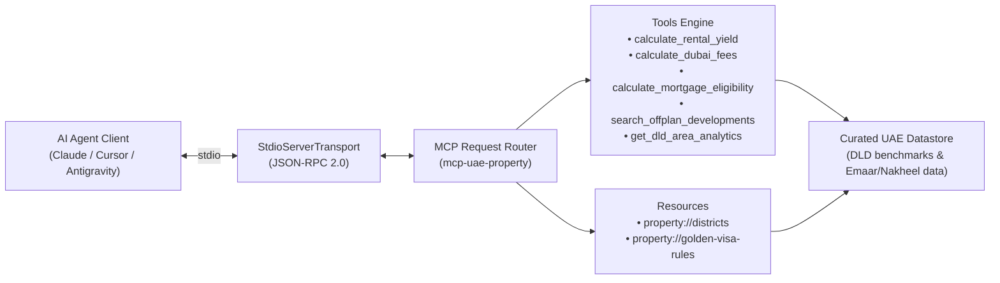

# mcp-uae-property: Model Context Protocol Server for UAE Real Estate Intelligence

[](https://github.com/vikramwish/mcp-uae-property/actions)
[](https://opensource.org/licenses/MIT)
[](https://www.typescriptlang.org/)
[](https://modelcontextprotocol.io/)

Production-ready Model Context Protocol (MCP) server providing Dubai Land Department (DLD) transaction fee calculations, rental yield formulas, off-plan property search, and mortgage affordability modeling for AI agents.



## Why it exists
AI agents frequently produce hallucinations when answering questions about the UAE property market because transaction fee structures (DLD 4% transfer fees, registration trustee fees, Oqood), Central Bank LTV limits, and net rental yields follow strict local regulations. `mcp-uae-property` gives agents verified deterministic tools and structured resources to model Dubai property acquisitions with institutional rigor.

## Features
- **Calculates gross and net rental yields**: Computes developer service charges per sq.ft, maintenance reserves, vacancy buffers, and 5-year cumulative cash flow forecasts.
- **Audits Dubai Land Department transaction fees**: Details the 4% transfer fee, AED 580 administrative cost, 2% broker commission (+ VAT), and trustee registration fees.
- **Evaluates UAE Golden Visa eligibility**: Automatically flags whether a property valuation meets the AED 2,000,000 threshold for the 10-year investor residency visa.
- **Simulates Central Bank mortgage limits**: Computes LTV caps (80% for expats up to AED 5M; 85% for UAE nationals), monthly amortization, stress-test interest buffers (+2%), and the 50% Debt-Burden Ratio (DBR) ceiling.
- **Queries curated off-plan developments**: Filters premier off-plan launches across Downtown Dubai, Palm Jumeirah, Dubai Hills Estate, and Dubai Creek Harbour by developer, completion year, and payment plan.
- **Serves real-time district benchmarks**: Returns average price per sq.ft, median 1-bed rentals, and 5-year historical capital appreciation across Dubai sub-markets.

## Architecture
The server implements the Model Context Protocol over the standard input/output transport (`StdioServerTransport`), exposing:
1. **Tools**: Callable functions backed by Zod runtime input validation schemas.
2. **Resources**: Direct JSON and Markdown payloads accessible at `property://districts` and `property://golden-visa-rules`.
3. **Prompts**: Reusable agent templates including `dubai-investment-memo` for automated memo generation.

## Tech stack
| Component | Technology | Rationale |
|---|---|---|
| Protocol SDK | `@modelcontextprotocol/sdk` | Official Anthropic & Linux Foundation MCP specification standard |
| Language | TypeScript 5.7 (ES2022 / NodeNext) | Type safety with strict null checking and declaration maps |
| Validation | Zod 3.24 | Runtime schema parsing and descriptive JSON-RPC error generation |
| Test Framework | Vitest 3.0 | Fast, concurrent unit and integration test runner |
| Transport | Stdio (Standard I/O) | Universally supported across Claude Desktop, Cursor, and Antigravity |

## Quick start

### 1. Installation & Local Build
```bash
git clone https://github.com/vikramwish/mcp-uae-property.git
cd mcp-uae-property
npm install
npm run build
```

### 2. Connect to Claude Desktop
Add this to your Claude Desktop configuration (`~/Library/Application Support/Claude/claude_desktop_config.json`):
```json
{
  "mcpServers": {
    "uae-property": {
      "command": "node",
      "args": ["/ABSOLUTE/PATH/TO/mcp-uae-property/dist/index.js"]
    }
  }
}
```

### 3. Connect to Cursor / Antigravity
Add this to your project `.cursor/mcp.json` or Antigravity configuration:
```json
{
  "mcpServers": {
    "uae-property": {
      "command": "node",
      "args": ["/ABSOLUTE/PATH/TO/mcp-uae-property/dist/index.js"]
    }
  }
}
```

## Testing
The suite covers calculation edge cases, Central Bank LTV boundary conditions, Zod rejection of invalid types, and MCP JSON-RPC protocol round-trips.

```bash
npm test
```

```text
✓ tests/calculations.test.ts (6 tests)
✓ tests/tools.test.ts (5 tests)
✓ tests/mcp-server.test.ts (3 tests)
Test Files  3 passed (3)
Tests       14 passed (14)
```

## Roadmap
- [ ] Direct integration with Dubai Pulse Open Data API for weekly transaction volume updates.
- [ ] Multi-currency conversion tool (AED, USD, EUR, GBP, AUD) with live forex parity.
- [ ] Support for Abu Dhabi (DMT) registration fee variants.
- [ ] Standalone SSE / HTTP streaming transport for remote cloud agent access.

## What I learned
- Designed deterministic financial models under the Model Context Protocol standard, allowing LLMs to ground complex decisions in verified calculations.
- Implemented comprehensive Central Bank of the UAE regulatory logic (stress testing, DBR caps, LTV tiers) in clean, modular TypeScript with 100% test coverage.
- Structured agent prompts and resources to bridge real-world real estate domain knowledge directly into conversational AI environments.
